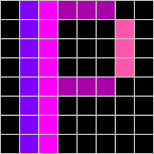
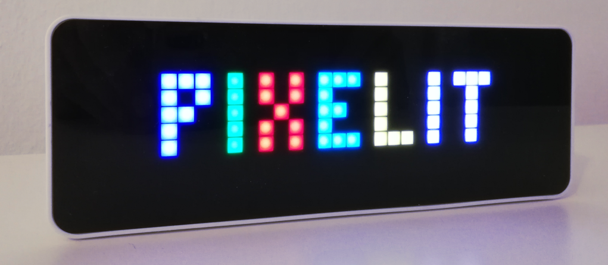
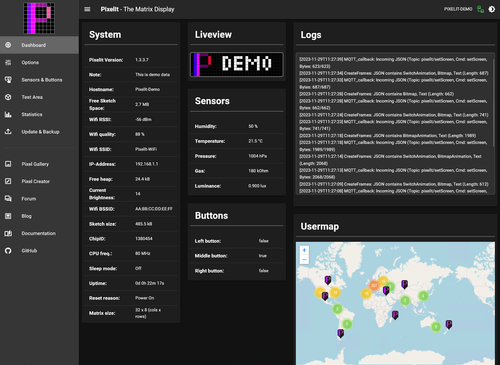
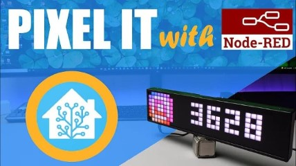

# PixelIt - The Matrix Display

     

The PixelIt is an ESP8266/ESP32 and WS2812B-LED based PixelArt display, controlled and fed via a JSON API.
Settings and small tests are possible via the web interface,
also a Node-RED node ([node-red-contrib-pixelit](https://flows.nodered.org/node/node-red-contrib-pixelit)) for the JSON API is available.

If you want to get an impression of the WebUI, you can do that here in [Demo WebUI](https://pixelit-project.github.io/PixelIt/webui/) :rocket:

-   :memo: [Documentation](https://pixelit-project.github.io/)
-   :green_heart: [PixelIt Icon Gallery (in Demo WebUI)](https://pixelit-project.github.io/PixelIt/webui/#/gallery)
-   :bulb: [GitHub Discussions (Forum)](https://github.com/pixelit-project/PixelIt/discussions) 
-   :speech_balloon: [Telegram Channel](https://t.me/pixelitdisplay) 
-   :speech_balloon: [Discord Channel](https://discord.gg/ERBSHWxB2S) 

## Project highlights

-   :fire: Support for **[Node-RED](https://pixelit-project.github.io/nodered.html)**, **[HomeAssistant](https://pixelit-project.github.io/webinterface.html#mqtt)** and **[ioBroker](https://pixelit-project.github.io/iobroker.html)**
-   :fire: Support for **[DIY Matrixes](https://pixelit-project.github.io/hardware.html#parts-list)** (ESP32/ESP8266) and prebuild **[Ulanzi TC001 Pixel Clock](https://www.ulanzi.com/products/ulanzi-pixel-smart-clock-2882?aff=1181)**\*
-   :fire: Awesome [WebUI](https://pixelit-project.github.io/PixelIt/webui/) for configuration and control. Checkout the **[Demo](https://pixelit-project.github.io/PixelIt/webui/)**
-   :fire: Great **[documentation](https://pixelit-project.github.io/)**
-   :fire: Unlimited possibilities through the open **[API](https://pixelit-project.github.io/api.html)**
-   :fire: Helpful and welcoming community on **[Telegram](https://t.me/pixelitdisplay)**, **[Discord](https://discord.gg/ERBSHWxB2S)** and **[GitHub Discussions](https://github.com/pixelit-project/PixelIt/discussions)**
-   :fire: Showroom for your own PixelIt builds on the **[Show you PixelIt](https://github.com/pixelit-project/PixelIt/discussions/48)** thread.

## Getting started

1. Follow the [hardware and setup documentation](https://pixelit-project.github.io/).
2. Install the firmware for your board from [GitHub Releases](https://github.com/pixelit-project/PixelIt/releases).
3. Open the device's IP address in your browser to configure it and send images.

## Bitmap animations

The current development firmware supports these limits over HTTP, MQTT and WebUI:

| Frame size (width × height) | Maximum frames |
| --- | ---: |
| 8×8 | 28 |
| 16×8 | 14 |
| 32×8 (full display) | 7 |

See [animation usage and examples](docs/animations.md) for the JSON format,
transport limits and diagnostics. These changes are currently **unreleased**.

## Development and changes

- [Build and test instructions](docs/development.md)
- [Changelog](CHANGELOG.md)

## Contributors

Thanks to these great people for supporting this project.

<!-- readme: contributors -start -->
<table>
	<tbody>
		<tr>
            <td align="center">
                <a href="https://github.com/o0shojo0o">
                    
                     
                    <b>o0shojo0o</b>
                </a>
            </td>
            <td align="center">
                <a href="https://github.com/foorschtbar">
                    
                     
                    <b>foorschtbar</b>
                </a>
            </td>
            <td align="center">
                <a href="https://github.com/miccgn">
                    
                     
                    <b>miccgn</b>
                </a>
            </td>
            <td align="center">
                <a href="https://github.com/rliegmann">
                    
                     
                    <b>rliegmann</b>
                </a>
            </td>
            <td align="center">
                <a href="https://github.com/jekader">
                    
                     
                    <b>jekader</b>
                </a>
            </td>
            <td align="center">
                <a href="https://github.com/Metaln00b">
                    
                     
                    <b>Metaln00b</b>
                </a>
            </td>
		</tr>
		<tr>
            <td align="center">
                <a href="https://github.com/pplucky">
                    
                     
                    <b>pplucky</b>
                </a>
            </td>
            <td align="center">
                <a href="https://github.com/fmunozs">
                    
                     
                    <b>fmunozs</b>
                </a>
            </td>
            <td align="center">
                <a href="https://github.com/rozza-m">
                    
                     
                    <b>rozza-m</b>
                </a>
            </td>
            <td align="center">
                <a href="https://github.com/Flolant">
                    
                     
                    <b>Flolant</b>
                </a>
            </td>
            <td align="center">
                <a href="https://github.com/hermannbach">
                    
                     
                    <b>hermannbach</b>
                </a>
            </td>
            <td align="center">
                <a href="https://github.com/d4rkd3v1l">
                    
                     
                    <b>d4rkd3v1l</b>
                </a>
            </td>
		</tr>
		<tr>
            <td align="center">
                <a href="https://github.com/hamster65">
                    
                     
                    <b>hamster65</b>
                </a>
            </td>
		</tr>
	<tbody>
</table>
<!-- readme: contributors -end -->

## WebUI

## Videos

## Disclaimer

\* This link and some others in the documentation are affiliate links. We would be happy if you use this link, but of course you don't have to.
